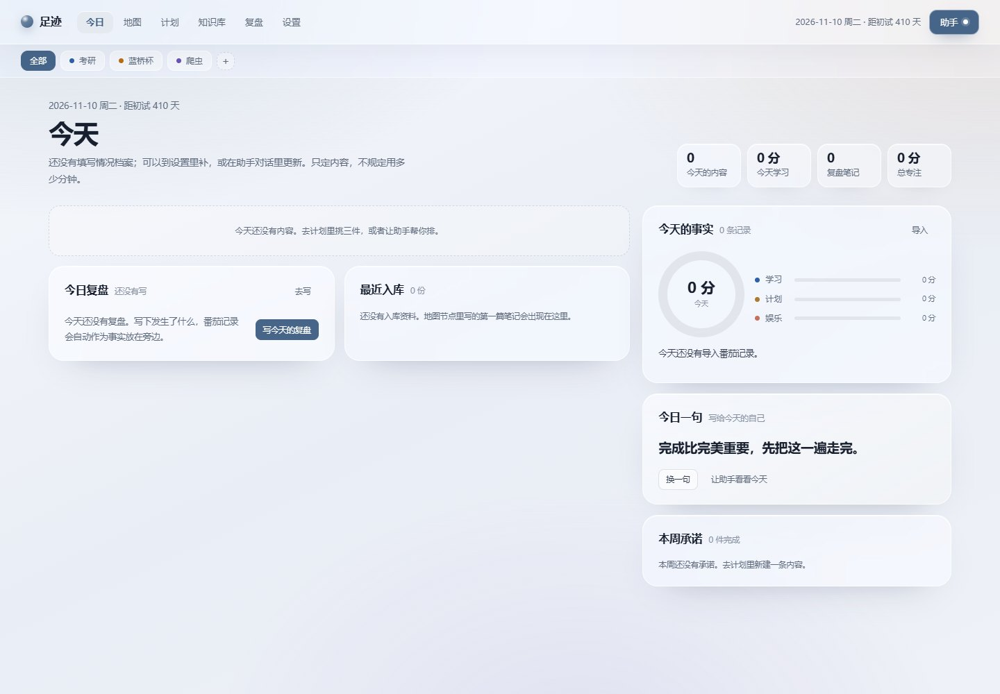
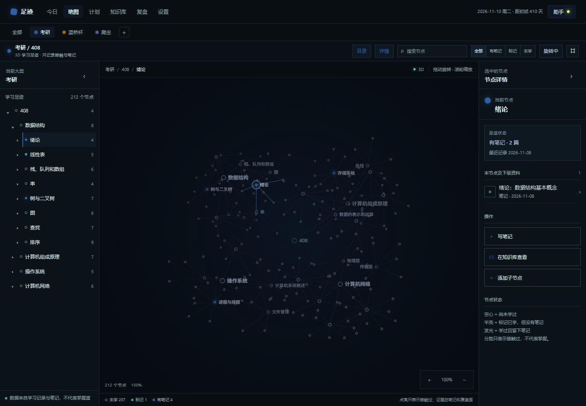

# 项目结构说明

本文说明 `足迹` 这个仓库里每个部分做什么、数据怎么流、部署时哪些文件会被使用。




## 1. 产品边界

这是一个纯前端学习系统原型，没有登录、数据库和文件上传服务。

它只做四件事：

1. 今天碰哪些内容；
2. 哪些知识节点学过、哪些留下笔记；
3. 番茄Todo的实际时间事实；
4. 每天自由复盘，每周按事实统计。

它明确不做：

- 不给内容排分钟，不预估任务用时；
- 不把“点亮”说成“掌握”；
- 不把计划、娱乐时间混进学习时长；
- 不在复盘里提问或写空泛鼓励。

## 2. 启动与部署

```bash
pnpm install
pnpm dev          # http://localhost:3000/
pnpm typecheck
pnpm build        # 构建并准备 standalone 资源
pnpm start        # 启动 standalone 生产服务
```

Docker：

```bash
docker build -t footprint .
docker run --rm -p 3000:3000 footprint
```

Vercel：导入仓库，Framework 选 Next.js，Build Command 为 `pnpm build`，不需要环境变量。

关键部署文件：

| 文件 | 用途 |
| --- | --- |
| `next.config.ts` | standalone 输出、旧路径重定向 |
| `Dockerfile` | 生产镜像 |
| `.dockerignore` | 镜像构建排除项 |
| `scripts/prepare-standalone.mjs` | 把 `public/` 和 `.next/static` 复制进 standalone |
| `scripts/start-standalone.mjs` | 本地启动 standalone server |
| `public/manifest.webmanifest` | PWA 名称、图标、主题色 |

## 3. 目录

```text
.
├─ src/
│  ├─ app/
│  │  ├─ layout.tsx              根布局、元信息、PWA 注册
│  │  ├─ page.tsx                唯一页面入口
│  │  ├─ proto.css               全站样式、3D 地图样式、玻璃卡
│  │  └─ api/ai/chat/route.ts    AI 请求代理
│  ├─ components/
│  │  ├─ PwaRegister.tsx         注册 service worker
│  │  └─ proto/
│  │     ├─ Prototype.tsx        应用壳、路由状态、localStorage、全局动作
│  │     ├─ Today.tsx            今日内容、事实、番茄导入
│  │     ├─ MapView.tsx          3D 知识地图、节点 CRUD、笔记预览
│  │     ├─ Plan.tsx             周内容板、进度、延期
│  │     ├─ Library.tsx          书 / 笔记 / 复盘架
│  │     ├─ Review.tsx           每日复盘、每周统计
│  │     ├─ Settings.tsx         大类、AI、映射、数据
│  │     ├─ Assistant.tsx        全局助手抽屉
│  │     ├─ data.ts              EMPTY / SEED 数据、408 节点
│  │     ├─ map408.ts            从教材书签提取的 181 个节
│  │     ├─ pomodoro.ts          SpreadsheetML .xls 解析
│  │     ├─ types.ts             AppData / KNode / Doc / PlanItem 等类型
│  │     └─ ui.tsx               时间格式、Donut、StackBar、Modal
├─ public/                       PWA 图标、manifest、service worker
├─ docs/ARCHITECTURE.md          本文件
├─ scripts/                      standalone 构建与启动辅助
└─ README.md                     快速开始
```

## 4. 页面与入口

根路径 `/` 是唯一入口，视图通过查询参数记录：

| 视图 | 地址 |
| --- | --- |
| 今日 | `/` |
| 地图 | `/?view=map&space=ky` |
| 计划 | `/?view=plan&space=ky` |
| 知识库 | `/?view=library&space=ky` |
| 复盘 | `/?view=review&space=ky` |
| 设置 | `/?view=settings&space=ky` |

旧入口 `/proto`、`/map`、`/plan`、`/library`、`/review`、`/settings` 在 `next.config.ts` 中重定向到根路径，避免出现两套界面。

`Prototype.tsx` 负责：

- 当前视图和大类；
- 读取/保存 `localStorage`；
- 顶部导航、大类切换；
- 节点标记、笔记弹窗；
- 计划更新；
- 复盘保存；
- AI 配置更新；
- 把 URL 查询参数和当前视图同步。

## 5. 数据模型

`src/components/proto/types.ts`：

- `Space`：大类，带名称、颜色、说明、截止日期。
- `KNode`：知识节点，`state` 只有 `empty | marked | noted`；`custom` 表示用户自建；`parentId` 决定树。
- `Doc`：资料，`kind` 为 PDF / Markdown / 图片 / 复盘；笔记有 `body`。
- `PlanItem`：周内容。支持完成标准、依据、优先级、截止、状态，以及 `goalAmount / doneAmount / unit / progressNote` 和延期字段。
- `Session`：番茄记录，含日期、开始时间、分钟、任务、分类、匹配节点、来源。
- `ImportBatch`：一次导入的文件名、条数、重复数、日期范围。
- `AiConfig`：服务商、Base URL、模型、API Key、温度。
- `AppData`：以上数据的集合，加上 `profile`（情况档案）和 `prefs`（复盘节奏、任务映射）。

`EMPTY` 和 `SEED` 都在 `data.ts`：

- `EMPTY` 是首次打开的默认值：没有计划、番茄记录、复盘、资料和已学状态，保留目录骨架。
- `SEED` 是设置页“载入示例数据”使用的演示数据。

localStorage 键名是 `footprint-v1`。

## 6. 今日与番茄导入

`Today.tsx`：

- 今日只展示最多三件未完成内容；
- 完成只分“完成 / 部分完成”，部分完成必须写目标量、完成量、单位和说明；
- 今日事实来自 `sessions`，按番茄记录显示完整日期和开始时间；
- 导入按钮打开真实文件选择器，读取 `.xls`（SpreadsheetML XML）；
- 预览前 8 条、显示任务归类、重复数；
- 确认后按「日期 + 开始时间 + 待办名称」去重；
- 0 分钟记录保留，但不计入时长统计；
- 任务归类写入 `prefs.taskRoutes`，下次记住。

`pomodoro.ts` 负责：

- XML 用 `DOMParser` 解析；
- 支持 Excel 序列日期和常见日期字符串；
- 识别开始时间、待办名称、专注时长、心得、状态、完成度；
- 读取 `ss:Index` 跳列；
- 输出统一的 `ParsedPomodoroRow`。

复盘会把「导入记录」和「原型示例」分开显示。真实使用时，初始种子数据已经被清空。

## 7. 3D 知识地图

`MapView.tsx` 没有引入 Three.js，使用 Canvas 2D 做三维投影：

- `layoutGraph` 按父子关系生成 3D 坐标；
- 每帧用 yaw / pitch / perspective 投影到屏幕；
- 默认自动旋转，拖动改变旋转，滚轮或双指改变缩放；
- 搜索会旋转视角把命中节点转到正面；
- 节点状态用形状与亮度区分：空心 / 半亮 / 发光；
- 只记录“接触过”，不表达掌握度。

节点操作：

- 选中节点：查看状态、挂载笔记、聚焦、写笔记、标记已学；
- 添加子节点：输入标题，生成空心 `custom` 节点；
- 编辑标题：只改标题，不改变节点 ID、状态和笔记；
- 删除节点：只允许删除自建节点；子节点随父节点删除，关联笔记回挂到上一级；
- 笔记点击：直接弹出预览，Markdown 显示正文，可继续跳知识库。

笔记预览也在 `Library.tsx` 的文档卡片里可用。

## 8. 计划、复盘与知识库

`Plan.tsx`：

- 五列内容板：待做 / 进行中 / 完成 / 部分完成 / 搁置；
- 新建内容只要求内容、完成标准、依据、优先级、截止，可选目标数量；
- 没有预计分钟；
- 记录进度会写入完成量和说明；
- 延期会保留原截止、新截止和原因。

`Review.tsx`：

- 每日：自由写；自动事实块显示当天番茄记录、来源、完整时间；
- 每周：时间构成、每日投入、内容完成、部分完成、延期、足迹增量；
- 部分完成列出目标和实际完成量；
- 延期列出原截止、新截止和原因；
- 没有导入的日期显示没有记录，不伪造 0；
- 批注只引用上方事实。

`Library.tsx`：

- 按大类 / 科目分组；
- 书、笔记、复盘在同一个架子上；
- 类型只是筛选条件；
- 文档卡片可以预览 Markdown、复盘事实和 PDF 摘要。

## 9. AI 配置与代理

设置页的「AI 接口」支持：

- DeepSeek、OpenAI、自定义 OpenAI 兼容接口；
- Base URL、模型、API Key、温度；
- 保存到 `localStorage`；
- 测试连接；
- 清除 Key。

`/api/ai/chat` 只做代理：

- 客户端把当前配置和消息发到本站接口；
- 服务端请求 `{baseUrl}/chat/completions`；
- 不写日志、不落库、不把 Key 发送到配置之外的服务；
- 允许 HTTPS；本地调试允许 `localhost` / `127.0.0.1`。

助手在 `Assistant.tsx` 中：

- 有 API Key 时调用真实接口，带当前页面、节点、计划、最近番茄事实作为系统上下文；
- 没有 Key 时保留脚本回答；
- 支持中断请求；
- 仍遵守“不排分钟、部分完成写量、延期写原因、复盘只陈述”的提示词规则。

注意：API Key 存在浏览器，适合个人自托管；公共多用户部署应改成服务端密钥和后端鉴权。

## 10. 样式与视觉

`src/app/proto.css` 是唯一界面样式文件：

- 浅色页面：冷色背景、玻璃卡、细白边、内高光；
- 深色地图：独立工作台，强调色跟随大类；
- 大类颜色：考研蓝 `#2f5fa8`、蓝桥杯橙 `#b96b12`、爬虫紫 `#6b52b8`；
- 图表颜色与页面强调色分离：学习蓝、计划金、娱乐珊瑚，避免学习与计划混淆；
- 字体统一中文黑体，标题、正文、按钮共用一套字体；
- 移动端：两列统计、抽屉面板、底部导航。

## 11. 已知限制

- 只有前端，数据存在浏览器，换设备不会同步。
- 没有账号体系，部署到公网后任何访问者看到的是各自浏览器里的数据。
- AI Key 是个人配置，不适合公共多租户。
- 3D 地图是 Canvas 投影，不是 WebGL；212 节点性能足够，继续放大需要做 LOD。
- 资料上传和云端 AI 计费尚未接后端。
- 408 节点来自教材目录，其他大类保留样例骨架，用户可继续添加自己的节点。